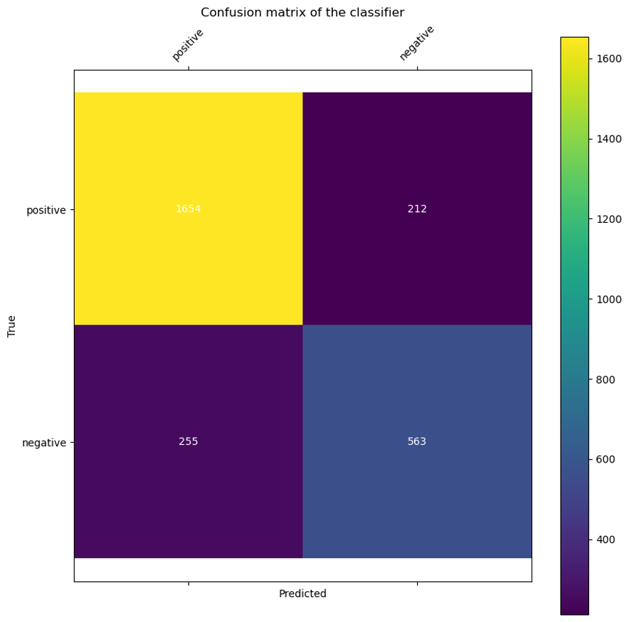
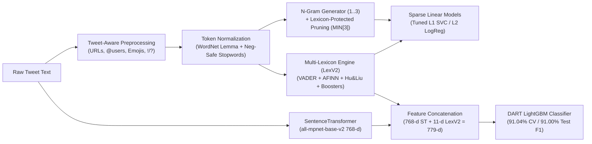

# Hybrid Tweet Sentiment Analysis: Multi-Lexicon Heuristics, Sparse N-Grams, and Dense Semantic Embeddings

[](https://www.python.org/)
[](https://scikit-learn.org/)
[](https://lightgbm.readthedocs.io/)
[](https://www.sbert.net/)
[](#6-comprehensive-ablation--benchmark-results)
[](#6-comprehensive-ablation--benchmark-results)
[-blue)](#6-comprehensive-ablation--benchmark-results)
[](LICENSE)

An end-to-end sentiment classification framework for noisy social media text, progressing systematically from a custom Term-Frequency (TF) Bag-of-Words baseline (`82.74%` 10-fold CV F1) to an optimized multi-lexicon sparse linear pipeline (`88.20%` test F1) and a hybrid neural-symbolic architecture fusing **SentenceTransformer (`all-mpnet-base-v2`)** dense embeddings with **VADER + AFINN + Hu & Liu (`LexV2`)** valence heuristics and **DART-boosted LightGBM** (`91.04%` 10-fold CV F1 / `91.00%` test F1).

---

## 1. Executive Summary & Benchmark Highlights

Short-form social media posts present acute challenges for traditional natural language processing: informal syntax, creative spelling, pervasive `@user` mentions and URLs, attached punctuation (`sunday!(:`), polysemous proper nouns, negated clauses, and class imbalance. This repository implements a rigorous, modular NLP pipeline and documents a **24-stage ablation study** across feature engineering, lexicon fusion, regularization, model ensembling, and dense transformer representations:

| Stage / Architecture | Core Representation | Classifier | 10-Fold CV F1 (%) | Held-Out Test F1 (%) | $\Delta$ vs. Baseline (CV) |
| :--- | :--- | :--- | :---: | :---: | :---: |
| **Baseline (Q1–Q2)** | Raw `.split()` + Term Frequency (TF) BoW (`104,038` feats) | `LinearSVC` (Default) | 82.74 | 83.38 | — |
| **Tweet Preprocessing** | Tweet-aware cleaning + WordNet Lemmatization + Custom Stopwords | `LinearSVC` (Default) | 84.66 | 85.11 | `+1.92%` |
| **N-Gram Context** | Lemmatization + Stopwords + Unigrams & Bigrams (`N[2]`) + `MIN[3]` | `LinearSVC` (Default) | 85.03 | 85.52 | `+2.29%` |
| **LexV1 + L1 SVC** | `N[3]` + `MIN[3]` + `LexV1` (Counts & Lexicon Protection) | `LinearSVC (C=0.2, L1, balanced)` | 87.72 | 87.86 | `+4.98%` |
| **LexV2 + L1 SVC** | `N[3]` + `MIN[3]` + `LexV2` (VADER/AFINN + Negation/Booster Rules) | `LinearSVC (C=0.2, L1, balanced)` | 87.99 | 87.94 | `+5.25%` |
| **LexV2 + Tuned LR** | `N[3]` + `MIN[3]` + `LexV2` (`143,135` protected features) | `LogisticRegression (C=0.25, L2, balanced)` | 88.15 | 88.20 | `+5.41%` |
| **Hybrid ST + LexV2** | **`all-mpnet-base-v2` (768-d) $\oplus$ `LexV2` (11-d) (`779` feats)** | **`LightGBM (DART, 1500 trees, L1/L2=20)`** | **91.04** | **91.00** | **`+8.30%`** |

---

## 2. Dataset & Task Formulation

The corpus (`data/sentiment-dataset.tsv`) comprises **33,540 annotated English tweets** labeled for binary sentiment polarity (`positive` vs. `negative`). Following a strict **80% / 20% train-test protocol**:
- **Training & Cross-Validation Split (80%):** `26,832` tweets partitioned into 10 folds (`~2,683` validation instances and `~24,149` training instances per fold iteration).
- **Held-Out Test Split (20%):** `6,708` unseen tweets reserved strictly for final out-of-sample evaluation.
- **Class Distribution & Evaluation Metric:** Because positive tweets outnumber negative tweets by roughly $2.28:1$ (e.g., `1,866` positive vs. `818` negative instances in Fold 1), raw accuracy is insensitive to minority-class recall. All models are evaluated using **weighted Precision, Recall, F1-score, and Accuracy**, ensuring balanced sensitivity across both polarities.

---

## 3. Baseline Architecture & 10-Fold Cross-Validation

### 3.1 Term-Frequency Bag-of-Words (`to_feature_vector_dictionary`)
Rather than binary presence/absence indicators, the baseline representation uses **Term Frequency (TF)** weights via `collections.Counter`. Repeated tokens within a tweet (such as multiple exclamation marks or repeated emotive adjectives) carry stronger sentiment signal than single occurrences. Across the `26,832` training tweets, whitespace tokenization (`text.split()`) yields an unpruned vocabulary of **104,038 unique features**.

### 3.2 10-Fold Cross-Validation Performance
Evaluating the baseline `LinearSVC` across all 10 validation folds produces:
- **10-Fold CV Weighted Precision:** `82.72%` (`0.8272`)
- **10-Fold CV Weighted Recall:** `82.88%` (`0.8288`)
- **10-Fold CV Weighted F1-Score:** `82.74%` (`0.8274`)
- **10-Fold CV Accuracy:** `82.88%` (`0.8288`)
- **Held-Out Test Set F1-Score:** `83.38%` (`0.8338` — Precision `83.34%`, Recall `83.51%`)

---

## 4. Deep Error Analysis & Linguistic Diagnostics

To diagnose the structural weaknesses of the baseline linear classifier, we evaluate the first validation fold (`2,684` instances) and inspect both the confusion matrix and exact token-level decision margins:

$$\text{Score}(x) = \sum_{t \in x} w_t \cdot \text{TF}(t, x) + b, \quad \text{where } b = +0.2353$$

<p align="center">
  
</p>

### 4.1 Confusion Matrix Breakdown (Validation Fold 1)
| Ground Truth \ Predicted | Predicted `positive` | Predicted `negative` | Total | Class Recall | Error Rate |
| :--- | :---: | :---: | :---: | :---: | :---: |
| **True `positive`** | **1,654** (TP) | **212** (FN — Type II) | 1,866 | 88.64% | 11.36% |
| **True `negative`** | **255** (FP — Type I) | **563** (TN) | 818 | 68.83% | **31.17%** |
| **Total** | 1,909 | 775 | 2,684 | — | 17.40% |

Because the dataset skews positive, the unregularized SVM learns a positive intercept bias ($b = +0.2353$) and achieves `88.64%` recall on positive tweets, but suffers a **31.17% false positive rate on negative tweets** (`255` FP vs. `563` TN).

### 4.2 Token-Weight Inspection (`analyze_prediction_errors_with_weights`)
Our custom diagnostic function extracts the learned `LinearSVC` hyperplane coefficients (`w_t`) and intercept (`b = +0.2353`), exporting all `212` False Negatives (`false_negatives.txt`) and `255` False Positives (`false_positives.txt`) while decomposing individual misclassifications:

1. **False Negative Case Study (Attached Emoticons & Spurious Neutral Weights):**
   > *"They made a sky zone here in Covina across the street from AMC. I'm definitely going sunday!(: who's down?"*
   - **Margin Decomposition:** $\text{Token Sum} = -0.3206$, $\text{Intercept} = +0.2353 \implies \text{Final Score} = -0.0852 < 0$ (Predicted `negative`, True `positive`).
   - **Root Cause:** Because whitespace tokenization fails to separate punctuation and emoticons from words, `sunday!(:` is treated as an out-of-vocabulary/zero-weight token (`0.0000`), losing both the exclamation mark `!` and the happy emoticon `(:`. Meanwhile, neutral prepositions and nouns learned spurious negative weights (`across`: `-0.3665`, `sky`: `-0.2473`, `street`: `-0.0969`), overpowering the positive bias.

2. **False Positive Case Study (User Mentions, Stopwords & Uncaptured Context):**
   > *"@CheleReamey @funder @ZeldaShagnasty @FBI @TheJusticeDept yes I know but Comey should be pressured for further explanation about letter ."*
   - **Margin Decomposition:** $\text{Token Sum} = -0.0303$, $\text{Intercept} = +0.2353 \implies \text{Final Score} = +0.2050 > 0$ (Predicted `positive`, True `negative`).
   - **Root Cause:** Non-sentiment conversational fillers (`yes`: `+0.4412`, `explanation`: `+0.3518`, `know`: `+0.0963`) and user handles (`@funder`: `-0.1089`, `@FBI`: `-0.1042`) dominate the hyperplane equation, preventing the negative context (`pressured`: `-0.0847`, `Comey`: `-0.4826`) from overcoming the `+0.2353` intercept.

3. **Sarcasm, Profanity Slang & Proper Noun Bias (FP Examples 2 & 3):**
   - In *"Nicki's pastor is mad af right now. And it's Sunday smh"* ($\text{Score} = +0.1924$), possessive proper nouns (`Nicki's`: `+0.6035`, `Sunday`: `+0.1822`) outweigh negative slang (`smh`: `-0.4017`, `af`: `-0.2744`, `mad`: `-0.1417`).
   - In *"Well with Zayn joining ISIS it is hard to maintain their family friendly image."* ($\text{Score} = +0.3952$), sarcastic surface words (`joining`: `+0.5743`, `Zayn`: `+0.2264`, `friendly`: `+0.1738`) mask the negative proposition (`ISIS`: `-0.4059`).

---

## 5. Multi-Stage Optimization Architecture



### 5.1 Tweet-Aware Pre-processing (`PRE`) & Token Normalization
Implemented in [`src/sentiment_analyzer/preprocessing.py`](src/sentiment_analyzer/preprocessing.py):
- **Noise Removal:** Strips URLs (`http\S+|www\S+`), `@user` mentions, retweet prefixes (`\brt\b`), numeric tokens, and ellipses (`...`, `…`), while stripping `#` symbols from hashtags (`keep_word`) so `#happy` normalizes to `happy`.
- **Emoji & Emoticon Normalization:** Separates Unicode emojis from adjacent characters; in `option_1` (`LexV1`), translates emojis via `emoji.demojize` (`:emoticon_...:`) and groups ASCII emoticons into `__emoticon_pos__` and `__emoticon_neg__`. In `option_2` (`LexV2`), isolates ASCII emoticons as distinct tokens so they can be scored directly by `AFINN-emoticon-8` and `VADER`.
- **Punctuation & Abbreviation Handling:** Expands `w/` $\to$ `with`, removes non-sentiment punctuation, and isolates `!` and `?` as independent tokens.
- **Negation-Preserving Stopword Removal (`Stop`):** Removes standard NLTK English stopwords **except** a curated 58-word negation set (`no`, `not`, `never`, `without`, `seldom`, `rarely`, `can't`, `won't`, `didn't`, etc.).
- **Lemmatization vs. Stemming:** WordNet Lemmatization (`Lemma`) and Porter Stemming (`Stem`) perform comparably (`84.67%` vs. `84.73%` CV F1), but **Lemmatization** is selected because it preserves exact lexical surface forms required for downstream dictionary lookups in VADER, AFINN, and Hu & Liu lexicons.

### 5.2 N-Grams, Weighting Schemes & Lexicon-Protected Pruning
Implemented in [`src/sentiment_analyzer/features.py`](src/sentiment_analyzer/features.py):
- **N-Gram Context (`N[2]`, `N[3]`):** Generating contiguous bigrams and trigrams (`not_good`, `not_very_good`) captures local compositional polarity.
- **TF vs. TF-IDF:** Replacing raw Term Frequency with TF-IDF degrades validation F1 (`84.99%` $\to$ `83.05%` on `N[3] + MIN[3]`) because inverse document frequency down-weights ubiquitous sentiment indicators (`good`, `love`, `bad`, `!`).
- **Minimum Document Frequency (`MIN[3]`) with Lexicon Pardon (`protect_lexicon_features`):** Removing n-grams with $\text{DF} < 3$ shrinks the raw trigram space from `488,507` to `23,352` features, Curbing overfitting. Crucially, our custom `is_lexicon_term()` filter **exempts** any unigram, bigram, or trigram containing a Hu & Liu sentiment word from `MIN[n]` pruning, retaining `143,155` high-signal features.

### 5.3 Multi-Lexicon Feature Engineering (`LexV1` vs. `LexV2`)
Implemented in [`src/sentiment_analyzer/lexicons.py`](src/sentiment_analyzer/lexicons.py) using external resources in `assets/lexicons/` (`2,006` Hu & Liu positive words, `4,783` Hu & Liu negative words, `3,474` AFINN-165 + emoticon entries, `7,506` VADER lexicon tokens, and `3,570` UTF-8 emoji descriptions):

- **`LexV1` (9 Count & Compositional Meta-Features):**
  Computes `__LEX_POS_COUNT__`, `__LEX_NEG_COUNT__`, `__META_TOKEN_COUNT__`, `__META_POS_EMO_COUNT__`, `__META_NEG_EMO_COUNT__`, `__META_EXCLAM_COUNT__`, `__META_QMARK_COUNT__`, and scans bigrams/trigrams for `[negation_word]_*_[lexicon_word]` patterns to populate `__META_NEGATED_POS_COUNT__` and `__META_NEGATED_NEG_COUNT__`. Adding `LexV1` with balanced class weights jumps validation F1 from `85.03%` to `86.78%` (`+1.75%`).

- **`LexV2` (11 Continuous Valence & Rule-Modulated Meta-Features):**
  Replaces simple counts with continuous valence scoring across **VADER** and **AFINN** modulated by compositional syntax rules:
  1. **3-Token Lookbehind Negation Inversion:** If any of the 3 preceding tokens is in `NEGATION_WORDS_SET`, the token's valence scalar is multiplied by VADER's empirical negation constant ($s_{\text{neg}} = -0.74$).
  2. **2-Token Lookbehind Booster/Dampener Scaling:** Intensifiers (`extremely`, `incredibly`, `really`, `so`, `very`) and downtoners (`barely`, `hardly`, `kinda`, `slightly`) within a 2-token window shift the scalar by $\pm 0.293$.
  3. **2-Token Lookahead Exclamation Amplification:** An exclamation mark `!` within 2 tokens after a sentiment word amplifies VADER magnitude by $+0.292$ and AFINN magnitude by $+1.0$.
  4. **Ensemble Polarity Aggregation:** Outputs `__LEX_SCORE_AFINN__`, `__LEX_SCORE_VADER__`, `__LEX_SCORE_BINGLIU_NET__` ($\text{Pos} - \text{Neg}$), and their composite mean `__LEX_SCORE_AVERAGE__`, improving identical `LinearSVC` configurations by `+0.27%` CV F1 (`87.72%` $\to$ `87.99%`).

### 5.4 Regularization, Linear Classifiers & Two-Stage Stacking
Implemented in [`src/sentiment_analyzer/models.py`](src/sentiment_analyzer/models.py):
- **Controlling Overfitting via Heavy Regularization:** Unregularized models achieve `99.98%` training F1 vs. `86.78%` validation F1. Applying **L1 regularization** (`penalty='l1'`, automatic sparse feature selection) with `class_weight='balanced'` and lowering $C$ from `1.0` $\to$ `0.5` $\to$ `0.3` $\to$ `0.2` compresses the train-validation gap (`93.13%` train vs. `87.99%` CV / `87.94%` test F1).
- **Tuned Logistic Regression (`LR`):** Training an L2-regularized `LogisticRegression(C=0.25, class_weight='balanced', max_iter=3000)` on the `LexV2` feature space achieves the highest traditional model performance: **`88.15%` CV F1** and **`88.20%` Test F1**.
- **Stacking Ensemble (`Stack(SVC + LR) -> LGBM`):** A two-stage stack combining out-of-fold decision margins from `LinearSVC(C=0.2, L1)` and `LogisticRegression(C=0.25, L2)` with the 11 `LexV2` meta-features into a `LightGBM` meta-learner achieves `88.01%` CV F1 (`87.65%` Test F1).

### 5.5 Hybrid SentenceTransformer + LexV2 + LightGBM Architecture
Implemented in [`src/sentiment_analyzer/embeddings.py`](src/sentiment_analyzer/embeddings.py):
- Sparse n-gram representations cannot generalize to unseen synonyms, idiomatic expressions, or implicit contextual sentiment.
- We encode raw tweets into dense semantic vectors using three pre-trained Siamese BERT (`SentenceTransformer`) backbones (`all-MiniLM-L6-v2` [384-d], `all-MiniLM-L12-v2` [384-d], and `all-mpnet-base-v2` [768-d]) and horizontally concatenate them with the **11 explicit `LexV2` rule-based sentiment features** (`779` total dimensions for `all-mpnet-base-v2`).
- A heavily regularized **DART-boosted LightGBM** classifier (`n_estimators=1500, learning_rate=0.2, max_depth=8, lambda_l1=20, lambda_l2=20, subsample=0.6, min_child_samples=70, is_unbalance=True`) trained on the hybrid `all-mpnet-base-v2 + LexV2` representation achieves **`91.04%` 10-fold CV F1** and **`91.00%` Test F1**.

---

## 6. Comprehensive Ablation & Benchmark Results

All 24 experimental configurations reported in Table I of our paper (evaluated via 10-fold cross-validation on the 80% training split and tested on the 20% held-out test split):

| # | Experiment Configuration | 10-Fold CV Train F1 (%) | 10-Fold CV Valid F1 (%) | Held-Out Test F1 (%) | Key Takeaway |
| :-: | :--- | :---: | :---: | :---: | :--- |
| 0 | **Baseline: Raw `.split()` + TF BoW + `LinearSVC()`** | — | 82.74 | 83.38 | Strong TF baseline (`104,038` raw tokens); high FP rate on negative class |
| 1 | `PRE + Lemma` | 99.51 | 84.67 | 84.91 | Tweet cleaning + WordNet lemmatization adds `+1.93%` CV F1 (`32,835` feats) |
| 2 | `PRE + Lemma + Stop` | 99.43 | 84.66 | 85.11 | Negation-preserving stopword removal improves test generalization (`+0.20%`) |
| 3 | `PRE + Stem` | 99.21 | 84.73 | 85.05 | Porter stemming matches lemmatization on unigrams (`28,640` feats) |
| 4 | `PRE + Stem + Stop` | 99.09 | 84.56 | 85.09 | Slight CV dip; Lemmatization preferred to preserve lexicon lookup integrity |
| 5 | `PRE + Lemma + Stop + MIN[2] + TF-IDF` | 99.86 | 79.56 | 80.11 | **TF-IDF hurts performance (`-5.10%`)** by penalizing frequent sentiment words |
| 6 | `PRE + Lemma + Stop + N[2] + MIN[3]` | 99.89 | 85.03 | 85.52 | Bigrams + `MIN[3]` pruning (`20,539` feats) captures local negation (`not_good`) |
| 7 | `PRE + Lemma + Stop + N[3] + MIN[3]` | 99.91 | 84.99 | 85.43 | Trigrams expand context (`23,352` pruned feats from `488,498` raw n-grams) |
| 8 | `PRE + Lemma + Stop + N[3] + MIN[3] + TF-IDF` | 99.99 | 83.05 | 83.83 | Confirms TF-IDF degradation even with higher-order n-grams |
| 9 | `PRE + Lemma + Stop + N[3] + MIN[4]` | 99.69 | 84.46 | 85.48 | Aggressive pruning (`15,785` feats) drops rare sentiment-bearing n-grams |
| 10 | `Lemma + Stop + N[2] + MIN[3] + LexV1 + SVC(cw:balanced)` | 99.98 | 86.78 | 86.95 | **`LexV1` + lexicon protection + balanced weights jumps CV F1 by `+1.75%`** |
| 11 | `Lemma + Stop + N[3] + MIN[4] + LexV1 + SVC(cw:balanced, pen:l1, iter:3000)` | 99.79 | 86.81 | 87.56 | L1 penalty performs automatic sparse feature selection (`+0.61%` Test F1) |
| 12 | `Lemma + Stop + N[3] + MIN[4] + LexV1 + SVC(C:10, cw:balanced, pen:l1, iter:3000)` | 99.99 | 86.06 | 87.18 | Weak regularization ($C=10$) exacerbates overfitting (`-0.75%` CV F1) |
| 13 | `Lemma + Stop + N[3] + MIN[4] + LexV1 + SVC(cw:balanced, pen:l2, iter:3000)` | 99.98 | 86.50 | 87.27 | L2 penalty underperforms L1 penalty on high-dimensional n-gram space |
| 14 | `Lemma + Stop + N[3] + MIN[4] + LexV1 + SVC(C:0.5, cw:balanced, pen:l1, iter:3000)` | 97.88 | 87.35 | 87.88 | Stronger L1 regularization ($C=0.5$) boosts CV F1 by `+0.54%` |
| 15 | `Lemma + Stop + N[3] + MIN[4] + LexV1 + SVC(C:0.3, cw:balanced, pen:l1, iter:3000)` | 95.10 | 87.66 | 87.61 | Further reduces train-val gap (`95.10%` vs `87.66%`) |
| 16 | `Lemma + Stop + N[3] + MIN[3] + LexV1 + SVC(C:0.2, cw:balanced, pen:l1, iter:3000)` | 93.13 | 87.72 | 87.86 | Optimal `LexV1` SVC configuration (`144,042` features) |
| 17 | `Lemma + Stop + N[3] + MIN[3] + LexV2 + SVC(C:0.2, cw:balanced, pen:l1, iter:3000)` | 93.13 | 87.99 | 87.94 | **`LexV2` (VADER + AFINN + negation/booster rules) adds `+0.27%` CV F1** |
| 18 | `Lemma + Stop + N[3] + MIN[3] + LexV2 + SVC(C:0.15, cw:balanced, pen:l1, iter:3000)` | 91.84 | 87.78 | 87.96 | Over-regularization begins to slightly trim CV F1 (`87.78%`) |
| 19 | `Lemma + Stop + N[3] + MIN[3] + LexV2 + LGBM(n_est:900, m_depth:7, is_unbal:True, ff:0.3, lr:0.1)` | 92.77 | 87.33 | 87.61 | Decision trees on sparse bag-of-ngrams trail linear hyperplanes |
| 20 | **`Lemma + Stop + N[3] + MIN[3] + LexV2 + LR(C:0.25, cw:balanced, pen:l2, iter:3000)`** | **96.10** | **88.15** | **88.20** | **Best sparse linear model (`88.15%` CV / `88.20%` Test F1)** |
| 21 | `Stack(SVC + LR) -> LGBM` | 97.69 | 88.01 | 87.65 | 2-level stacking ensemble matches linear models but does not beat tuned LR |
| 22 | `ST: all-MiniLM-L6-v2 + LexV2 -> LGBM` | 99.45 | 89.39 | 88.92 | 384-d transformer embeddings + `LexV2` (`395` feats) breaks `89%` barrier |
| 23 | `ST: all-MiniLM-L12-v2 + LexV2 -> LGBM` | 99.55 | 89.95 | 89.66 | Deeper 12-layer MiniLM backbone adds `+0.74%` Test F1 |
| 24 | **`ST: all-mpnet-base-v2 + LexV2 -> LGBM`** | **99.63** | **91.04** | **91.00** | **Best Overall Model (`779` hybrid features): `91.04%` CV / `91.00%` Test F1** |

---

## 7. Repository Structure

```text
hybrid-tweet-sentiment-analysis/
├── .github/workflows/
│   └── ci.yml                          # GitHub Actions CI pipeline (Python 3.10 & 3.11)
├── assets/lexicons/                    # Curated sentiment & social media lexicons
│   ├── AFINN-emoticon-8.txt            # AFINN ASCII emoticon valence scores
│   ├── AFINN-en-165.txt                # AFINN-165 English word valence scores (-5 to +5)
│   ├── emoji_utf8_lexicon.txt          # 3,570 Unicode emoji descriptors
│   ├── negative-words.txt              # Hu & Liu (Bing Liu) 4,783 negative opinion words
│   ├── positive-words.txt              # Hu & Liu (Bing Liu) 2,006 positive opinion words
│   └── vader_lexicon.txt               # VADER 7,506 social media lexical valence ratings
├── data/
│   └── sentiment-dataset.tsv           # 33,540 annotated tweets (80% train / 20% test)
├── docs/assets/
│   └── confusion_matrix.png            # First-fold validation confusion matrix heatmap
├── scripts/
│   ├── train_and_evaluate.py           # CLI for running any Table I experiment configuration
│   └── run_error_analysis.py           # CLI for confusion matrix & token-weight FP/FN inspection
├── src/sentiment_analyzer/
│   ├── __init__.py                     # Package exports
│   ├── preprocessing.py                # Tweet-aware regex normalization, emojis & lemmatization
│   ├── features.py                     # TF BoW, n-gram generation & lexicon-protected pruning
│   ├── lexicons.py                     # LexV1 & LexV2 (VADER, AFINN, Hu & Liu, negation/boosters)
│   ├── embeddings.py                   # Hybrid SentenceTransformer + LexV2 feature extractor
│   ├── models.py                       # LinearSVC, LogisticRegression, LightGBM & Stacking builders
│   └── evaluation.py                   # 10-fold CV, weighted metrics & weight-based error analysis
├── tests/
│   └── test_sentiment_pipeline.py      # Comprehensive pytest suite covering all modules
├── LICENSE                             # MIT License
├── pyproject.toml                      # Modern PEP 621 package configuration
└── requirements.txt                    # Reproducible runtime & test dependencies
```

---

## 8. Quickstart & CLI Usage

### 8.1 Installation
```bash
git clone https://github.com/Ceviche98/hybrid-tweet-sentiment-analysis.git
cd hybrid-tweet-sentiment-analysis
pip install -e ".[dev]"
```

### 8.2 Running Experiments from the Command Line
Evaluate any preset configuration from our ablation table using `scripts/train_and_evaluate.py`:

```bash
# 1. Run the best sparse linear model: Lemma + Stop + N[3] + MIN[3] + LexV2 + Tuned LogisticRegression (88.20% Test F1)
python scripts/train_and_evaluate.py --preset lr_lexv2_best

# 2. Run the tuned L1 LinearSVC with LexV2 features (87.99% CV / 87.94% Test F1)
python scripts/train_and_evaluate.py --preset svc_lexv2_best

# 3. Run the winning hybrid architecture: SentenceTransformer (all-mpnet-base-v2) + LexV2 + DART LightGBM (91.04% CV / 91.00% Test F1)
python scripts/train_and_evaluate.py --preset st_mpnet_lgbm

# 4. Reproduce the baseline Term-Frequency Bag-of-Words 10-fold CV (82.74% CV F1)
python scripts/train_and_evaluate.py --preset baseline_bow
```

### 8.3 Running Weight-Based Error Analysis
Generate the first-fold confusion matrix heatmap and inspect the exact linear token weights driving False Positive and False Negative classifications:

```bash
python scripts/run_error_analysis.py --output-dir outputs --top-n 3
```

### 8.4 Running the Test Suite
```bash
pytest -v
```

---

## 9. References

1. **Hutto, C. J., & Gilbert, E. (2014).** *VADER: A Parsimonious Rule-based Model for Sentiment Analysis of Social Media Text.* Proceedings of the Eighth International AAAI Conference on Weblogs and Social Media (ICWSM-14), pp. 216–225.
2. **Nielsen, F. Å. (2011).** *A new ANEW: Evaluation of a word list for sentiment analysis in microblogs.* Proceedings of the ESWC2011 Workshop on 'Making Sense of Microposts' (arXiv:1103.2902).
3. **Hu, M., & Liu, B. (2004).** *Mining and summarizing customer reviews.* Proceedings of the ACM SIGKDD International Conference on Knowledge Discovery and Data Mining, pp. 168–177.
4. **Reimers, N., & Gurevych, I. (2019).** *Sentence-BERT: Sentence Embeddings using Siamese BERT-Networks.* Proceedings of the 2019 Conference on Empirical Methods in Natural Language Processing (EMNLP-IJCNLP), pp. 3982–3992.
